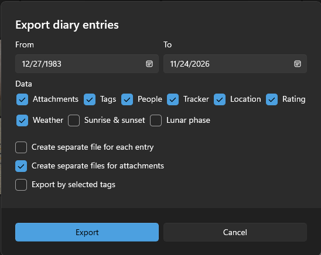

# diarium

Scripts/Utilities for Diarium (https://diariumapp.com/en) journaling.

## Config

To get started, save `/src/config.template.psd1` as `/src/config.psd1` and update the `ZipFolder` in `/src/config.psd1` with the folder you extract your Diarium entries too. For example:

```
@{
    ZipFolder = 'C:\Users\you\Backup\Diarium'
}
```

## ConvertToMarkdown.ps1

This script takes the location (folder) where you export your Diarium journal to, extracts the contents of the zip file, and writes your entries to date based `Diarium\YYYY\MM` folders with attachments and location included.

### Export

When exporting from Diarium be sure to save as json (not docx or other formats), and check the option for "Create separate files for attachments"




